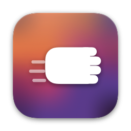
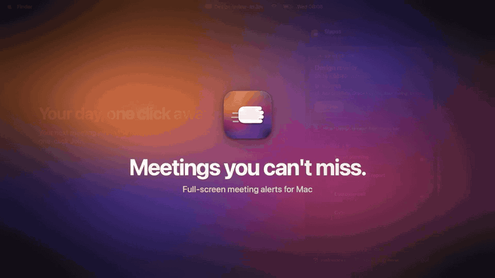

# Slapss

**Meetings you can't miss.**

A free, open-source full-screen meeting reminder for Mac.

### [Download on the Mac App Store](https://apps.apple.com/app/id6767488326)

[slapss-app.com](https://slapss-app.com) · [Changelog](CHANGELOG.md) · [Support](https://slapss-app.com/support)

---

Notifications are built to be ignored. A small banner, a soft chime, gone in three
seconds. By the time you look up, you are already late.

Slapss does the opposite. It sits in your menu bar, watches your calendar, and when
a meeting starts it covers your screen with the one thing you need to see and a
button to join.

*Free forever. No subscription, no in-app purchase, no account, no tracking.*

## What you get

- **A full-screen alert you can't scroll past.** On one display or all of them, at
  the start of the meeting or up to 15 minutes before.
- **One click to join.** Zoom, Microsoft Teams, Google Meet, Webex, Whereby, Around
  and Yandex Telemost links open straight from the alert, even when your company's
  email security has wrapped them.
- **Your day in the menu bar.** The next meeting and a live countdown, with today's
  agenda one click away.
- **Snooze that comes back.** 1, 5, 10, 15 or 30 minutes, an hour, or until the
  meeting ends. Press Escape to dismiss.
- **Less noise.** Skip the alert for meetings like "Lunch" or "PTO", or for ones you
  haven't accepted. Presenting Now holds alerts while you share your screen.
- **Reminders too.** Full-screen alerts for macOS Reminders, with one-click completion.
- **Make it yours.** Three themes (Sunset, Ocean, Forest), an optional alert sound,
  and eight languages: English, Turkish, Spanish, German, Italian, French, Japanese,
  Ukrainian.
- **Accessible.** VoiceOver labels, a keyboard-operable alert, and Reduce Motion and
  Reduce Transparency support.

  
  

## Works with your calendar

Anything in macOS Calendar: **iCloud, Google Calendar, Outlook and Exchange**.
Work calendar on **Microsoft 365**? Sign in right inside Slapss, no Calendar.app
setup needed. Guides for [Outlook](https://slapss-app.com/outlook-meeting-reminder-mac)
and [Google Calendar](https://slapss-app.com/google-calendar-reminder-mac).

## Who it's for

People who miss meetings because a notification banner never reaches them:
back-to-back meetings, several monitors, long screen-sharing sessions, or deep
focus and [hyperfocus](https://slapss-app.com/adhd-meeting-reminder). If calendar
notifications keep slipping past you, Slapss is the one you can't scroll past.

## Private by design

There is no Slapss server. Your calendar is read on your Mac and sent nowhere. No
analytics, no crash reporting, no accounts. Microsoft 365 events come straight from
Microsoft with a read-only permission, and the sign-in stays in your keychain.

You don't have to take that on faith: the code is right here.
[DEVELOPMENT.md](DEVELOPMENT.md#privacy-details) shows exactly what the app touches
and how to check the copy you installed.

## Open source

Slapss is open source under the [Apache License 2.0](LICENSE), with no third-party
dependencies. Want to read how it works, build it yourself, or help out? Start with
[DEVELOPMENT.md](DEVELOPMENT.md) and [CONTRIBUTING.md](CONTRIBUTING.md). Found a
security issue? See [SECURITY.md](SECURITY.md).

Requires macOS 15 or later.

---

The Slapss name, app icon, menu bar mark, and logo are trademarks and not covered
by the code license; a fork needs its own name and icon, see [TRADEMARK.md](TRADEMARK.md).
The only official build is the one on the [Mac App Store](https://apps.apple.com/app/id6767488326).

I built Slapss to fix a problem I kept running into myself, and shared it so it can
help others too. If it saved you a meeting or two, you can
[buy me a coffee on GitHub Sponsors](https://github.com/sponsors/theshiver). Thank you!

Made by [Can Çetin](https://cancetin.com/).

